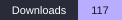

# UltraBar Studio

A community-built Windows companion for UltraBar X / CoreBAR. Independent of the official UltraBarX software.

[Download UltraBar Studio for Windows](https://github.com/qlerup/ultrabar-studio/releases/latest)

## Get started

1. Install Studio and choose **Connect device**. The setup guide covers first-time CoreBAR setup.
2. Open **Design & actions** to arrange the CoreBAR screen or configure module buttons.
3. Choose **Save draft** to keep your work locally and **Deploy to Core** to review and apply changes to CoreBAR.

- See connected modules, status and saved screen previews.
- Arrange your desk layout around a centered CoreBAR.
- Mix large and small widgets in the CoreBAR preview. Hover over an empty slot and use **+** to split it into four cells. Drag cards into position.
- Choose VivoCube screen pictures and action icons, with verified button registration on Core.
- Review package-update progress and choose Deploy now or Later; pending activation stays visible.
- Drag separate website and PC app widgets onto Core; upload a picture or use the program icon automatically.
- Add live CPU, RAM, GPU and disk widgets where supported.
- Browse the **UltraBarX**, **Studio**, **App Store** and **Other apps & widgets on Core** library groups.
- Save local drafts and backups, and download verified Studio updates in the app. The installer replaces program files and keeps saved data.

Native Studio widgets currently require a root-enabled ARM32 CB01 running LineOS 1.0.8 or 1.0.9, with Studio connected. Small widgets and mixed layouts require LineOS 1.0.9. GPU readings depend on available sensors. Other firmware has not been verified.

## App & Plugin Store

Install a supported package from **App & Plugin Store**. Widgets appear in the
**App Store** library in Design & actions. Drag a widget into the CoreBAR preview,
configure it and deploy. Supported Core apps can also be placed in **Background
apps**. Native widgets use Studio's shared runtime, with dedicated large and small
presentations where the package supports them.

Developers can submit their own supported apps, widgets and presets so other users can install them through the Store. Keep the source in your own repository, publish a release and submit a Store PR. New packages require maintainer acceptance; eligible updates to registered packages can auto-merge after checks. [Read the submission guide](https://github.com/qlerup/ultrabar-store/blob/main/SUBMIT-A-PACKAGE.md). Use **Install from folder** in Studio to test locally before submitting.

## Windows security warning

Studio's Windows installer and executable are currently not code-signed. Windows may show an **unrecognized app**, **unknown publisher** or **Windows protected your PC** warning because the file or publisher does not have an established reputation. That reputation warning alone does not mean malware has been detected; it is also not a guarantee that software is safe or free of defects. See [Microsoft's SmartScreen explanation](https://learn.microsoft.com/windows/apps/package-and-deploy/smartscreen-reputation).

Download Studio only from this repository's official [Releases](https://github.com/qlerup/ultrabar-studio/releases). Each release includes the Windows installer, a SHA-256 checksum file and metadata for the in-app updater. Verify the source and decide whether you trust the download before running it.

## Independence and use at your own risk

UltraBar Studio is an independent community project. It is **not developed in collaboration with, affiliated with, endorsed by or supported by the team behind UltraBarX / CoreBAR**. Product names and trademarks belong to their respective owners.

Studio is actively under development and is available for testing. You use Studio and third-party packages **at your own risk**. The software is provided **as is**, without warranties, including warranties of fitness, reliability or compatibility. You are responsible for your device configuration, backups and any changes you deploy.

To the maximum extent permitted by applicable law, the authors and contributors accept no liability for loss of data, device malfunction, damage, interruption or other losses arising from use of Studio or installed packages. This does not exclude rights or liability that cannot lawfully be excluded. See [LICENSE](../LICENSE).

## License

Proprietary source-available software, not open source. You may use unmodified official releases. Modifying, redistributing or building derivative versions requires written permission. See [LICENSE](../LICENSE). Third-party components retain their own licenses.

Bug reports and feedback are welcome in [Issues](https://github.com/qlerup/ultrabar-studio/issues).
